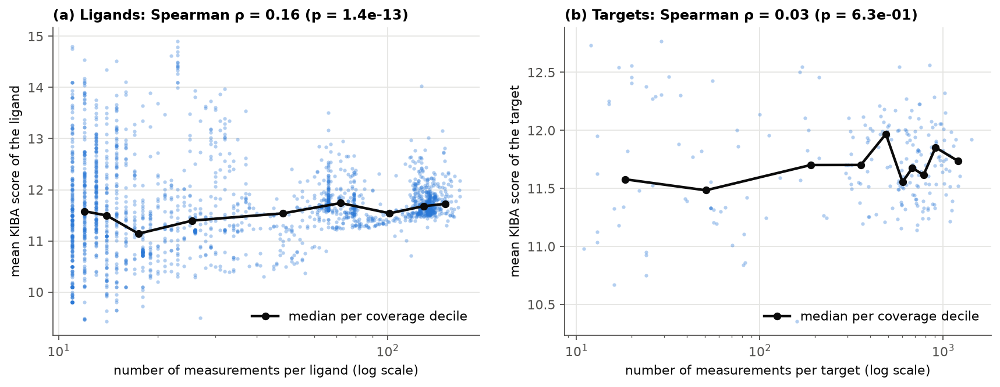
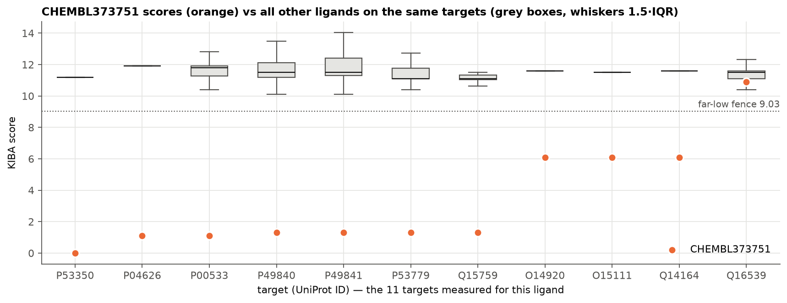
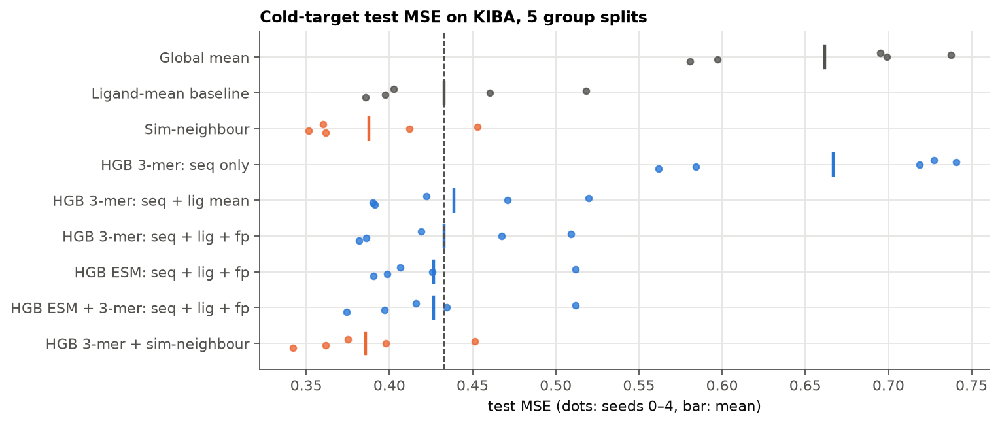
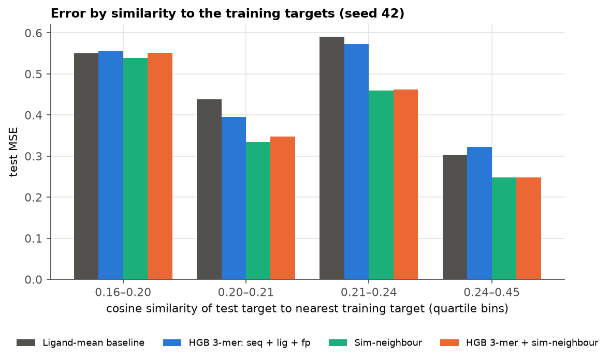

# SC4020 Project 2 — Drug–Target Binding Affinity

| Task | Scope | Status |
|---|---|---|
| **1 — Dataset analysis** | **KIBA** | ✅ complete (this page) |
| **3 — Cold-target generalisation** | **KIBA** | ✅ complete ([below](#task-3--cold-target-generalisation-on-kiba)) |

---

# Task 1 — Analysis of the KIBA dataset

**Notebook:** [`notebooks/task1_kiba.ipynb`](notebooks/task1_kiba.ipynb) · **Figures:** [`figures/kiba/task1/`](figures/kiba/task1/) · **Tables:** [`results/kiba/task1/`](results/kiba/task1/) · **Cleaned data:** [`data/processed/`](data/processed/)

### Key findings at a glance

- **Sparse:** only 117,657 of 473,572 ligand–target positions are measured (**75.2 % missing**). Missing means *never tested*, not *non-binding*.
- **Hidden duplicates:** IDs are unique, but **43 ligand IDs are stereoisomers** that share a canonical SMILES. Merging them removes 597 redundant pairs; isomers disagree by 0.44 score units on average.
- **One abnormal ligand:** CHEMBL373751 accounts for 10 of the 20 extreme-low scores, including KIBA's only zero. Its scores average **3.3** against a dataset mean of **11.7**. It is flagged and kept.
- **Heaped scores:** **22.9 %** of all pairs score exactly **11.1 or 11.2**, a floor-like screening effect.
- **Ligand identity matters most:** knowing the ligand explains **41.7 %** of score variance; knowing the target explains only **14.1 %**.
- **Similar proteins bind alike:** target pairs in the top 5 % of sequence similarity have a median profile correlation of **0.54**, against **0.23** for dissimilar pairs.

---

## 1. What the data is

KIBA (Tang et al., 2014) combines three kinds of bioactivity measurement (Ki, Kd and IC50) for kinase inhibitors into one **KIBA score**. We use the transformed version released with DeepDTA (Öztürk et al., 2018), where **higher = stronger binding**.

| File (`data/kiba/`) | Content |
|---|---|
| `ligands_can.txt` / `ligands_iso.txt` | JSON `CHEMBL ID → SMILES` (canonical / isomeric), 2,111 ligands |
| `proteins.txt` | JSON `UniProt ID → amino-acid sequence`, 229 kinase targets |
| `kiba_binding_affinity_v2.txt` | 2,111 × 229 score matrix; `nan` = not measured |
| `kiba_drug_sim.txt`, `kiba_target_sim.txt` | Drug–drug (PubChem) and target–target (Smith–Waterman) similarity matrices |
| `folds/` | DeepDTA cross-validation indices (used only as a consistency check) |

**Table 1 — Data format examples**

Ligands (SMILES truncated):

| ligand_id | canonical SMILES | SMILES length |
|:--|:--|--:|
| CHEMBL1087421 | `COC1=C(C=C2C(=C1)CCN=C2C3=CC(=C(C=C3)Cl)Cl)Cl` | 45 |
| CHEMBL1088633 | `COC1=C(C=C2C(=C1)CCN=C2C3=CC(=CC=C3)Cl)Cl` | 41 |
| CHEMBL1090360 | `C1COCCN1C2=CC(=CC=C2)NC3=NC=CC(=N3)C4=C(N=C5N…` | 83 |

Targets (sequence truncated):

| target_id (UniProt) | amino-acid sequence | length |
|:--|:--|--:|
| O00141 | `MTVKTEAAKGTLTYSRMRGMVAILIAFMKQRRMGLNDFIQKIANN…` | 431 |
| O00311 | `MEASLGIQMDEPMAFSPQRDRFQAEGSLKKNEQNFKLAGVKKDIE…` | 574 |
| O00329 | `MPPGVDCPMEFWTKEENQSVVVDFLLPTGVYLNFPVSRNANLSTI…` | 1044 |

Score matrix (first 5 ligands × 6 targets):

| ligand \ target | O00141 | O00311 | O00329 | O00418 | O00444 | O14757 |
|:--|--:|:--|:--|:--|:--|:--|
| CHEMBL1087421 | 11.1 | `nan` | `nan` | `nan` | `nan` | `nan` |
| CHEMBL1088633 | 11.1 | `nan` | `nan` | `nan` | `nan` | `nan` |
| CHEMBL1090360 | 12.1 | 12 | `nan` | `nan` | `nan` | 12.12 |
| CHEMBL1688215 | 11.1 | `nan` | `nan` | `nan` | `nan` | 11.1 |
| CHEMBL1765781 | 12.1 | `nan` | `nan` | `nan` | `nan` | 12.1 |

The matrix is converted to a **long format** with one row per measured pair (`ligand_id, target_id, score`). That format is used for all analysis.

---

## 2. Problems found in the raw data

| # | Problem | Evidence | How we handle it |
|---|---|---|---|
| 1 | **Most pairs were never measured** | 365,165 of 483,419 positions are `nan` (75.54 %) | Drop from the observation table; never fill with 0 |
| 2 | **Stereoisomer duplicates** | 43 CHEMBL IDs share a canonical SMILES (32 groups, up to 8 isomers); their isomeric SMILES all differ | Merge by canonical SMILES and average repeated pairs (§3.2) |
| 3 | **An abnormal ligand** | CHEMBL373751's 11 scores range 0–10.9 (mean 3.3); every other ligand averages ≥ 9.4 | Flag and keep (§3.3, Fig. 5) |
| 4 | **Heaped values** | 11.2 and 11.1 alone account for 22.9 % of all pairs; 52 % of scores have a single decimal | Flag and keep; discussed with the KDE (Fig. 2) |
| 5 | **Very uneven coverage** | Ligands have 11–166 measured targets; targets have 11–1,432 measured ligands | Shown in Fig. 3; tested for bias in Fig. 4 |
| 6 | **Multi-component SMILES** | 21 SMILES contain salts or counter-ions (`.`) | Flagged (`is_salt`) in the ligand table, not altered |

No file was inconsistent. The notebook asserts that the matrix shape matches both ID lists, that the canonical and isomeric files list ligands in the same order, and that the DeepDTA fold indices cover exactly the 118,254 observed entries.

---

## 3. Cleaning — what we did and how

### 3.1 Cleaning log

| Step | Operation | Rows in | Rows out | Change | Note |
|--:|:--|:--|:--|:--|:--|
| 1 | Matrix → long format | 483,419 positions | 118,254 pairs | 365,165 NaN dropped | NaN = not measured (never set to 0) |
| 2 | Non-finite scores | 118,254 | 118,254 | 0 | no ±inf present |
| 3 | Range / input validity | 118,254 | 118,254 | 0 | all scores ≥ 0; all sequences use the 20 standard amino acids |
| 4 | Merge stereoisomers (canonical SMILES) | 118,254 | 117,657 | 597 merged | 473 pairs averaged |
| 5 | Abnormal-value flags | 117,657 | 117,657 | **0 removed** | 29,877 rows carry ≥ 1 flag |

KIBA has no raw Kd, so the brief's "require positive Kd" rule does not apply. The supplied scores are already on a transformed scale, so we do not transform them again.

### 3.2 Duplicates — checked at every identity level

Whether two records count as duplicates depends on how ligands and targets are identified, so we tested every key the dataset offers:

| Identity key | Records | Unique | Redundant |
|:--|--:|--:|--:|
| Ligand ID (CHEMBL) | 2,111 | 2,111 | 0 |
| Isomeric SMILES | 2,111 | 2,111 | 0 |
| **Canonical SMILES** | 2,111 | **2,068** | **43** |
| Target ID (UniProt) | 229 | 229 | 0 |
| Protein sequence | 229 | 229 | 0 |
| (ligand ID, target ID) pair | 118,254 | 118,254 | 0 |
| **(canonical SMILES, sequence) pair** | 118,254 | **117,657** | **597** |

Duplicates appear **only** when ligands are identified by canonical SMILES. Canonical SMILES drops 3-D stereochemistry, so stereoisomers collapse to the same string, and any model that reads canonical SMILES would see one input with several labels. Before merging, we measured how much the isomers actually disagree:

| Stereoisomer agreement | Value |
|:--|:--|
| isomer pairs measured on the same target | 952 |
| mean / median absolute difference | 0.441 / 0.301 |
| identical scores | 24.1 % |
| pairs differing by more than 1.0 | 86 |
| Pearson r between isomers | 0.857 |

The isomers agree strongly (r = 0.86) but not perfectly. Each group is merged into its **lowest CHEMBL ID**, and repeated pairs take the **mean** score. For the 29 two-member groups the mean and median are identical anyway. To keep the disagreement visible, every cleaned row records `n_merged`, `score_std` and `source_ids`, and `kiba_ligand_map.csv` maps all 2,111 original IDs to their representative.

### 3.3 Abnormal values — flagged, never removed

Outliers use Tukey's *far-out* fences (Q1 − 3·IQR = **9.03**, Q3 + 3·IQR = **14.10**).

| Flag | Rule | Rows | % | Interpretation |
|:--|:--|--:|--:|:--|
| `flag_zero` | score = 0 | 1 | 0.00 % | KIBA's only zero, on target P53350. Kept, because the brief asks to keep valid zero scores |
| `flag_far_low` | score < 9.03 | 20 | 0.02 % | Extremely weak scores; 10 come from one ligand |
| `flag_low_ligand` | > 50 % of a ligand's scores are far-low | 11 | 0.01 % | CHEMBL373751, a ligand-level anomaly that likely comes from the score transformation of its source data |
| `flag_spike` | score exactly 11.1 or 11.2 | 26,922 | 22.88 % | Heaped values, consistent with rounded or thresholded source measurements (a screening-floor effect) |
| `flag_far_high` | score > 14.10 | 2,934 | 2.49 % | Very strong binders. Genuine, and the most interesting records |

**Sensitivity check:** what happens to the summary statistics if each flagged group is left out?

| Subset | Pairs | Mean | Median | SD | Skew | Min | Max | % ≥ 12.1 |
|:--|--:|--:|--:|--:|--:|--:|--:|--:|
| all cleaned pairs | 117,657 | 11.721 | 11.527 | 0.834 | 1.177 | 0.0 | 17.2 | 21.0 % |
| without far-low | 117,637 | 11.723 | 11.532 | 0.829 | 1.338 | 9.1 | 17.2 | 21.0 % |
| without low ligand | 117,646 | 11.722 | 11.531 | 0.830 | 1.328 | 7.1 | 17.2 | 21.0 % |
| without 11.1/11.2 spikes | 90,735 | 11.889 | 11.800 | 0.883 | 0.792 | 0.0 | 17.2 | 27.2 % |
| without far-high | 114,723 | 11.649 | 11.500 | 0.706 | 0.529 | 0.0 | 14.09 | 19.0 % |

The 20 extreme-low scores barely move the mean, but they inflate the spread, so they are worth flagging rather than worth deleting. The **spikes** matter much more: without them the median rises from 11.53 to 11.80 and the share of strong binders from 21 % to 27 %. The heaped values pull the distribution towards weak binding.

### 3.4 Counts — original vs cleaned

| | Original | Cleaned (deduplicated) |
|:--|:--|:--|
| ligands | 2,111 | **2,068** |
| targets | 229 | 229 |
| observed pairs | 118,254 | **117,657** |
| matrix positions | 483,419 | 473,572 |
| **sparsity** (missing / all positions) | **75.54 %** | **75.16 %** |
| mean observations per ligand | 56.0 | 56.9 |
| mean observations per target | 516.4 | 513.8 |

### 3.5 Outputs (`data/processed/`)

| File | Content |
|:--|:--|
| `kiba_pairs_clean.csv` | one row per measured pair: `ligand_id, target_id, score, score_std, n_merged, source_ids`, plus the five flag columns |
| `kiba_ligands.csv` | 2,068 ligands: canonical/isomeric SMILES, member IDs, `is_salt`, `is_low_ligand`, number of targets |
| `kiba_targets.csv` | 229 targets: sequence, length, number of ligands |
| `kiba_ligand_map.csv` | every original CHEMBL ID → its representative ID |

---

## 4. Visualisation

### Figure 1 — Ligand–target heatmap


Rows and columns are sorted by how many measurements they have. **White = not measured.** The matrix is not randomly sparse; it has a **block structure**. About 500 ligands were profiled against roughly the same 125 targets (top-left), and other ligand groups were tested only on specific target panels (for example the isolated block near targets 165–175). This is how screening campaigns produce data, and it means missing entries cluster rather than scatter. The zoom (b) shows that inside the dense block most scores sit in a narrow band (light blue), with strong binders (dark) concentrated in certain ligand rows and target columns.

### Figure 2 — Score distribution (KDE)


**(a)** The observed scores are strongly **right-skewed** (skew 1.18): a tall body between 11 and 12 and a long tail of strong binders up to 17.2. **21.0 %** of pairs reach the strong-binder threshold of 12.1 (Tang et al., 2014; He et al., 2017). The default KDE (Scott bandwidth) gives a smooth picture, but a narrow-bandwidth KDE and the histogram reveal **discrete spikes** at 11.1, 11.2, 11.5 and 11.9. KIBA scores are partly discretised, so a smooth KDE over-states how continuous they are.
**(b)** On a log-scaled count axis, the 20 far-low scores (orange) sit completely apart from the rest of the data, with a gap between about 2 and 6. They are invisible on a density plot, which is why both views are needed.

### Figure 3 — How many measurements each ligand and target has


Coverage is very uneven. **(a)** 830 ligands (40 %) were tested on only 11–20 targets (median 31), while a second group of 520 ligands was tested on 100 or more. **(b)** 51 targets have fewer than 100 measured ligands, while the median target has 567. Any method that compares ligands by their shared targets will have far more information for some ligands than for others.

### Figure 4 — Missing ≠ non-binding: is missingness linked to the score?



If pairs were missing at random, a ligand's average score would not depend on how many targets it was tested on. For **ligands** there is a small but significant link (Spearman ρ = 0.16, p = 1.4 × 10⁻¹³). Lightly-tested ligands vary much more and include both the weakest and the strongest averages. For **targets** there is none (ρ = 0.03, p = 0.63). The data are **not missing completely at random**: which pairs were measured depends on the ligand. That is a further reason not to read a missing entry as "does not bind".

### Figure 5 — The abnormal ligand CHEMBL373751



On each of its 11 targets, CHEMBL373751 (orange) scores far below what every other ligand scores on the same target (grey boxes). On 10 of the 11 it falls below the far-low fence, and it includes KIBA's only zero. Because the whole profile is shifted, not just one value, this looks like a systematic issue with this ligand's source data rather than random noise. We keep it with a `flag_low_ligand` marker so later tasks can choose whether to include it.

### Figure 6 — Stereoisomer consistency


**(a)** Scores of stereoisomer pairs on the same target lie close to the diagonal (r = 0.86); most fall inside the ±1 band. **(b)** 24 % agree exactly and the median gap is 0.30, but 86 pairs differ by more than 1.0, so stereochemistry sometimes changes binding. Averaging is a reasonable compromise when the input representation cannot distinguish isomers; the per-pair standard deviation is kept so this label noise stays visible.

### Figure 7 — Target properties


**(a)** Targets differ in how strongly they are bound: median scores range from **10.10 to 13.16**, but only 14 targets have a median above the 12.1 strong-binder line. The staircase of identical medians (11.1, 11.2, …) is the heaping effect from Fig. 2 showing up at target level. **(b)** The supplied Smith–Waterman similarity matrix, reordered by hierarchical clustering, shows clear diagonal blocks. These are **55 families** of related kinases (average similarity > 0.5, the largest with 8 members), while most target pairs are dissimilar (median similarity 0.08).

### Figure 8 — Do similar molecules / proteins have similar binding profiles?


For every pair of ligands (or targets) sharing at least 10 measured partners, we correlate their scores on those shared partners and plot the result against their structural similarity.

| Entity | Pairs | Spearman ρ (similarity, r) | Median r, bottom-50 % similarity | Median r, top-5 % similarity |
|:--|--:|--:|--:|--:|
| ligand | 842,004 | 0.072 | 0.12 | 0.30 |
| target | 17,096 | 0.213 | 0.23 | 0.54 |

**Targets:** sequence similarity is a meaningful signal. Related kinases have clearly more similar binding profiles. **Ligands:** structural similarity matters only at the very top, where near-identical compounds bind alike, and is weak elsewhere. This is the "guilt-by-association" principle behind similarity-based affinity prediction (He et al., 2017; Kim et al., 2025), measured directly on the KIBA data.

---

## 5. Where does the variation come from?

A two-way additive decomposition (score ≈ overall mean + ligand effect + target effect), fitted by alternating least squares on the observed pairs. This is a classical ANOVA-style summary, not a predictive model.

| Explained by | R² (share of score variance) |
|:--|--:|
| ligand identity only | 41.7 % |
| target identity only | 14.1 % |
| ligand + target (additive) | 51.9 % |
| residual (ligand × target interaction + noise) | 48.1 % |

**Which compound** it is matters about three times more than **which kinase** it is: some ligands bind strongly across the board (promiscuous inhibitors), others weakly. Still, almost half of the variation is *specific* to the ligand–target combination, which simple per-ligand or per-target averages cannot capture.

---

## 6. Limitations

- The cause of the heaped values and of CHEMBL373751's profile can only be inferred: the DeepDTA release does not include the raw Ki/Kd/IC50 records behind each KIBA score.
- Salt and counter-ion SMILES are flagged, not standardised. Stripping them properly needs a cheminformatics toolkit such as RDKit.
- Representing ligands by canonical SMILES deliberately ignores stereochemistry. Fig. 6 shows this costs some information (86 isomer pairs differ by > 1).
- The similarity analysis (Fig. 8) is correlational and uses only pairs with at least 10 shared partners.

---

# Task 3 — Cold-target generalisation on KIBA

**Notebook:** [`notebooks/task3_kiba.ipynb`](notebooks/task3_kiba.ipynb) · **Figures:** [`figures/kiba/task3/`](figures/kiba/task3/) · **Tables:** [`results/kiba/task3/`](results/kiba/task3/) · **Notes for the group:** [`results/kiba/task3/notes_for_group.pdf`](results/kiba/task3/notes_for_group.pdf)

**Question.** For a kinase never seen in training, how well can we predict each ligand's KIBA score from the target's sequence (plus ligand information)? Every test target is unseen, so no target-ID or target-mean features are used. The setup follows the group's shared Task 3 plan, which was written for DAVIS, so the two datasets can be compared.

### Key findings at a glance

- **The cold-target failure is real and measurable.** The ligand mean — which is exactly what Task 2's CF collapses to for an unseen target — scores a **within-ligand CI of 0.500 ± 0.000** on all 5 splits. For a given drug it ranks unseen kinases no better than chance, precisely the brief's *"cannot distinguish between different new targets"*.
- **Sequence features fix part of it, but MSE hides that.** The boosted sequence models are level with the baseline on test MSE (0.427–0.439) yet clearly ahead on ranking (within-ligand CI 0.536–0.559). "Seq only" reaches 0.555 using **no ligand information at all**. Judging by MSE alone would wrongly call sequence features useless.
- **A similarity-neighbour predictor is best on both counts**: test MSE **0.388** (beats the baseline on 5 of 5 splits) and within-ligand CI **0.601**, with no learning at all. It averages the ligand's own training scores, weighted by sequence similarity to the new kinase.
- **The gain concentrates where a relative exists in training**: error drops 18–24 % in the upper three similarity quartiles and only ~2 % in the least-similar one.

## 1. Setup

| Item | Setting |
|---|---|
| Data | Task 1 cleaned table: 2,068 ligands × 229 targets, 117,657 observed pairs; only observed pairs used |
| Groups | Targets clustered on the supplied Smith–Waterman matrix (average linkage, similarity > 0.5) → 150 groups, largest 8 |
| Split | Groups shuffled; cumulative row share ≤ 0.70 train, ≤ 0.85 validation, rest test. Seed 42 main run, seeds 0–4 repeats. No group or sequence crosses partitions ([checks](results/kiba/task3/split_checks.md)) |
| Sequence features | 3-mer frequencies (vocabulary from training sequences only) → TruncatedSVD 24, + 20 amino-acid fractions + log length; or ESM-2 (`facebook/esm2_t6_8M_UR50D`, mean-pooled, 1,000-residue chunks) → PCA 24 |
| Ligand features | Mean score over training targets (leaving out the row's own group for training rows); Morgan fingerprint (RDKit, r = 2, 1,024 count bits) → SVD 16 |
| Model | `HistGradientBoostingRegressor` (min_samples_leaf 40, no early stopping); depth {3, 5} × (lr, iterations) {(0.05, 300), (0.1, 150)}, chosen on validation MSE |
| Similarity-neighbour | Prediction = Σ s(t, t′)<sup>q</sup> y(l, t′) / Σ s(t, t′)<sup>q</sup> over the ligand's training targets t′; *q* chosen on validation; own-group targets excluded for training rows |
| Metrics | MSE; CI = (C + 0.5 T) / A on ≤ 20,000 test pairs (fixed seed); **CI within ligand** (the same CI restricted to pairs of targets of the *same* ligand — the brief's actual question, where a per-ligand-constant predictor scores exactly 0.5); CI on pairs with both scores > 11.2 (above the heaped 11.1 / 11.2 values); Hit@1 / Hit@5 / MRR for ligands with ≥ 5 held-out targets |

## 2. Why the ligand mean *is* the CF fallback

Biased matrix factorisation predicts r̂(i, j) = μ + b<sub>i</sub> + c<sub>j</sub> + **u**<sub>i</sub>·**v**<sub>j</sub>. For a target *j* with no training measurements, c<sub>j</sub> and **v**<sub>j</sub> receive no gradient and keep their initial values, so the prediction collapses to μ + b<sub>i</sub> — one constant per drug, repeated for every unseen target. The ligand-mean baseline is therefore not a strawman but the exact behaviour the brief describes, and its within-ligand CI of 0.500 is a mathematical consequence, confirmed empirically on all 5 splits.

## 3. Results (test set, 5 cold splits, mean ± std)

| Model | MSE train | MSE test | CI | CI within ligand | Hit@1 | Hit@5 | MRR | Beats baseline |
|---|---:|---:|---:|---:|---:|---:|---:|:--:|
| Global mean | 0.706 ± 0.018 | 0.662 ± 0.069 | 0.500 ± 0.000 | 0.500 ± 0.000 | 0.104 ± 0.014 | 0.449 ± 0.035 | 0.270 ± 0.017 | 0 of 5 |
| Random | 1.413 ± 0.032 | 1.382 ± 0.052 | 0.499 ± 0.001 | 0.499 ± 0.003 | 0.099 ± 0.012 | 0.442 ± 0.031 | 0.268 ± 0.015 | 0 of 5 |
| **Ligand-mean baseline** (= CF fallback) | 0.397 ± 0.009 | **0.433 ± 0.056** | 0.699 ± 0.013 | **0.500 ± 0.000** | 0.104 ± 0.014 | 0.449 ± 0.035 | 0.270 ± 0.017 | — |
| **Similarity-neighbour** *(new)* | 0.355 ± 0.015 | **0.388 ± 0.044** | 0.734 ± 0.016 | **0.601 ± 0.029** | 0.198 ± 0.047 | 0.601 ± 0.052 | 0.379 ± 0.042 | **5 of 5** |
| HGB 3-mer: seq only | 0.610 ± 0.011 | 0.667 ± 0.086 | 0.552 ± 0.030 | 0.555 ± 0.053 | 0.152 ± 0.070 | 0.534 ± 0.071 | 0.326 ± 0.060 | 0 of 5 |
| HGB 3-mer: seq + lig mean | 0.347 ± 0.016 | 0.439 ± 0.056 | 0.696 ± 0.017 | 0.536 ± 0.035 | 0.154 ± 0.025 | 0.506 ± 0.062 | 0.328 ± 0.031 | 1 of 5 |
| HGB 3-mer: seq + lig + fp | 0.281 ± 0.033 | 0.433 ± 0.055 | 0.698 ± 0.014 | 0.544 ± 0.029 | 0.172 ± 0.024 | 0.498 ± 0.043 | 0.333 ± 0.027 | 3 of 5 |
| HGB ESM: seq + lig + fp | 0.281 ± 0.026 | 0.427 ± 0.049 | 0.694 ± 0.020 | 0.550 ± 0.030 | 0.154 ± 0.051 | 0.498 ± 0.030 | 0.319 ± 0.038 | 2 of 5 |
| HGB ESM + 3-mer: seq + lig + fp | 0.282 ± 0.029 | 0.427 ± 0.053 | 0.700 ± 0.016 | 0.559 ± 0.028 | 0.163 ± 0.051 | 0.515 ± 0.044 | 0.331 ± 0.040 | 4 of 5 |
| **HGB 3-mer + similarity-neighbour** *(new)* | 0.247 ± 0.025 | **0.386 ± 0.042** | 0.728 ± 0.014 | **0.601 ± 0.042** | 0.204 ± 0.030 | 0.582 ± 0.027 | 0.377 ± 0.025 | **5 of 5** |

Full tables: [summary](results/kiba/task3/summary.md) · [paired vs baseline](results/kiba/task3/paired_vs_baseline.md) · [all seeds](results/kiba/task3/all_seeds.md) · [SVD sweep](results/kiba/task3/svd_sweep.md). "Beats baseline" counts the splits on which test MSE is lower than the ligand mean. The splits share data, so this is descriptive, not a significance test.



## 4. Analysis



- **Error vs similarity (seed 42).** Test rows are binned by the 3-mer cosine similarity of their target to the nearest training target. The neighbour models gain 18–24 % over the baseline in the upper three quartiles, and only ~2 % in the least-similar one. Cold-target prediction on KIBA works by transfer from related kinases.
- **Permutation importance (validation, [table](results/kiba/task3/permutation_importance.md)).** In the plan's model the ligand mean dominates (0.36 vs 0.02 for the 3-mer profile and 0.02 for the fingerprint), as on DAVIS. With the neighbour feature added, that feature takes over (0.58) and the ligand mean falls to 0.01, because the neighbour prediction already carries the ligand's level.
- **MSE and ranking disagree.** The sequence models match the baseline on MSE but beat it on within-ligand CI; the neighbour model wins on both. MSE is dominated by each ligand's overall level, which the ligand mean already supplies, so it is the less informative metric for this task. Both are reported.
- **ESM vs 3-mers ([table](results/kiba/task3/esm_vs_kmer.md)).** Nearly identical; ESM is better on 2 of 5 splits. Mean-pooled ESM-2 8M mostly encodes "kinase", which every target is.
- **SVD size.** Validation MSE moves from 0.52 (8–24 dims) to 0.50 (48–100 dims), small next to the split-to-split spread (std ≈ 0.07), so 24 is kept for comparability with DAVIS.

## 5. Limitations

- Similarity clusters at 0.5 still let distant paralogues sit on both sides of a split; large groups decide which targets land in test; the five splits are not independent.
- KIBA is 75 % missing, and its scores are a constructed consensus with heaped values at 11.1 / 11.2. Hit@k has a high chance level (random Hit@5 ≈ 0.45), because held-out ligands often have only 5–10 targets.
- The Smith–Waterman matrix comes with the data and uses sequences only (no labels), so using it for unseen targets is legitimate.
- These cold-target numbers are **not** comparable with DeepDTA's random-split results (MSE 0.194, CI 0.863).

---

## Reproduce

```bash
python -m venv .venv
# Windows: .venv\Scripts\activate   |   macOS/Linux: source .venv/bin/activate
pip install -r requirements.txt
jupyter nbconvert --to notebook --execute --inplace notebooks/task1_kiba.ipynb
jupyter nbconvert --to notebook --execute --inplace --ExecutePreprocessor.timeout=1800 notebooks/task3_kiba.ipynb
```

Every number, table and figure on this page is regenerated by these two notebooks. Task 1 runs in under a minute. Task 3 takes about 13 minutes on a laptop CPU; the first run also downloads the ESM-2 model (30 MB) and caches the embeddings in `data/processed/kiba_esm2_t6_8M.npy`.

## Repository structure

```
data/
  kiba/                  original KIBA files from DeepDTA (unchanged)
  processed/             cleaned KIBA tables + cached ESM embeddings (shared by both tasks)
notebooks/
  task1_kiba.ipynb       Task 1 — KIBA dataset analysis
  task3_kiba.py          Task 3 — source (jupytext percent format; edit this one)
  task3_kiba.ipynb       Task 3 — executed notebook, generated from task3_kiba.py
figures/kiba/
  task1/                 Task 1 figures (fig1 … fig8)
  task3/                 Task 3 figures (fig1 test MSE by seed, fig2 error vs similarity)
results/kiba/
  task1/                 Task 1 tables (CSV + Markdown)
  task3/                 Task 3 tables (CSV + Markdown) + notes_for_group.pdf
```

## References

1. Öztürk, H., Özgür, A., & Ozkirimli, E. (2018). DeepDTA: deep drug–target binding affinity prediction. *Bioinformatics*, 34(17), i821–i829. Data and loading convention: <https://github.com/hkmztrk/DeepDTA/tree/master/data>
2. Tang, J., Szwajda, A., Shakyawar, S., et al. (2014). Making sense of large-scale kinase inhibitor bioactivity data sets: a comparative and integrative analysis. *J. Chem. Inf. Model.*, 54(3), 735–743.
3. He, T., Heidemeyer, M., Ban, F., Cherkasov, A., & Ester, M. (2017). SimBoost: a read-across approach for predicting drug–target binding affinities using gradient boosting machines. *J. Cheminformatics*, 9, 24.
4. Kim, Y., et al. (2025). MixingDTA: improved drug–target affinity prediction by extending mixup with guilt-by-association. *Bioinformatics*, 41(Supplement_1), i105–i114.
5. Tukey, J. W. (1977). *Exploratory Data Analysis*. Addison-Wesley.
6. Lin, Z., Akin, H., Rao, R., et al. (2023). Evolutionary-scale prediction of atomic-level protein structure with a language model. *Science*, 379(6637), 1123–1130. (ESM-2)
7. RDKit: Open-source cheminformatics. <https://www.rdkit.org>
