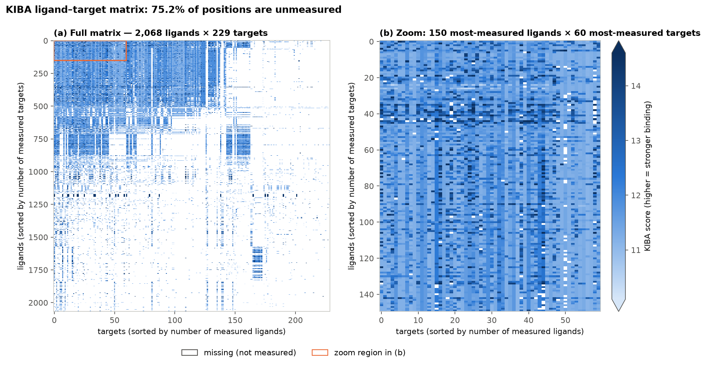
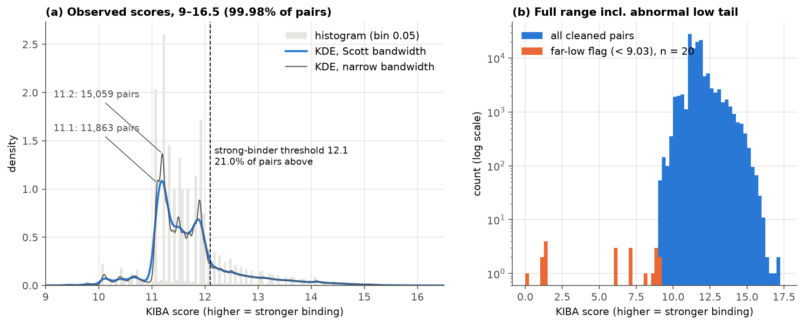
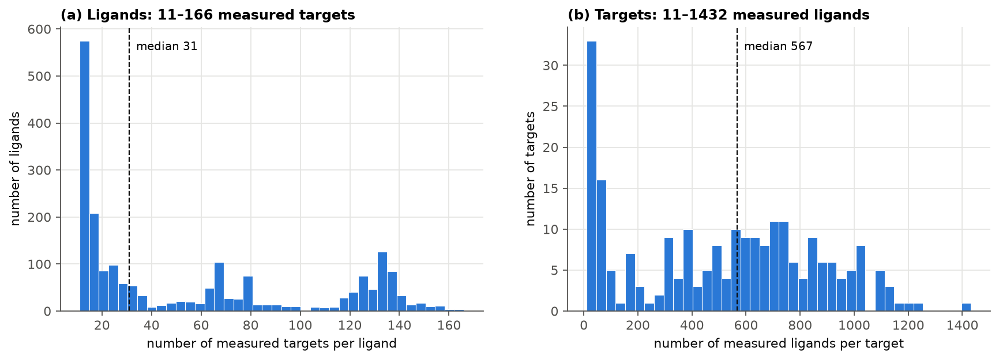
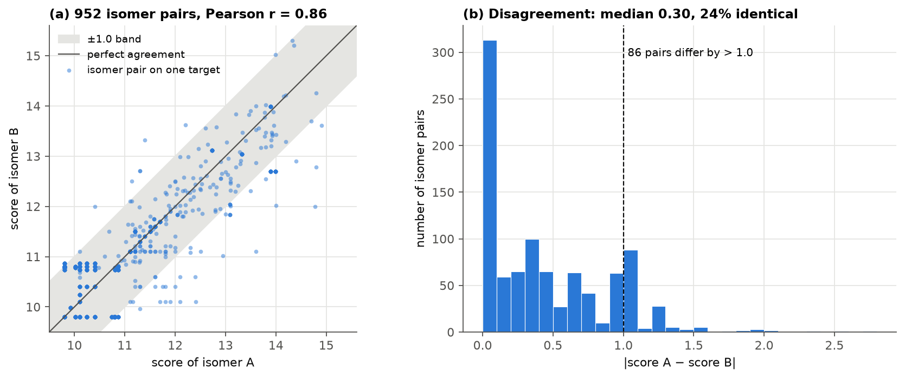
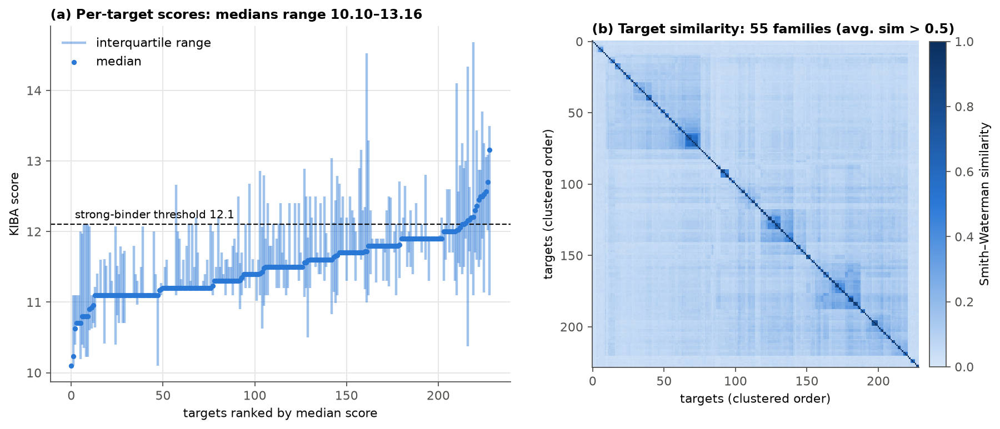
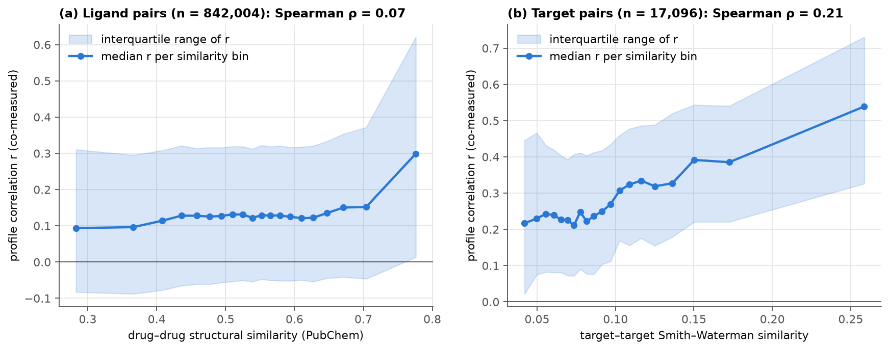
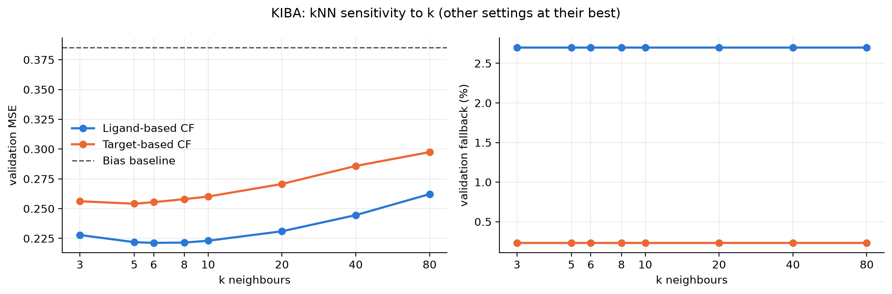
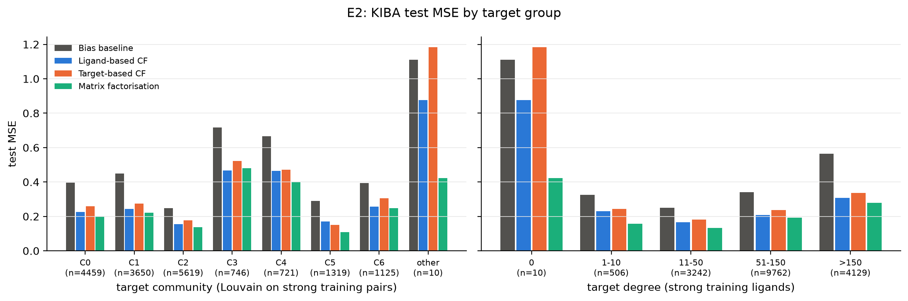
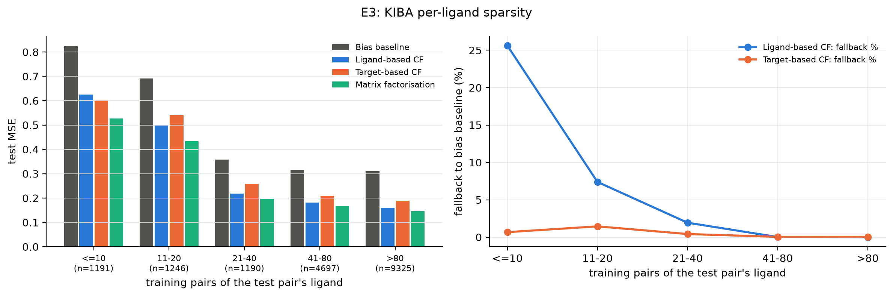
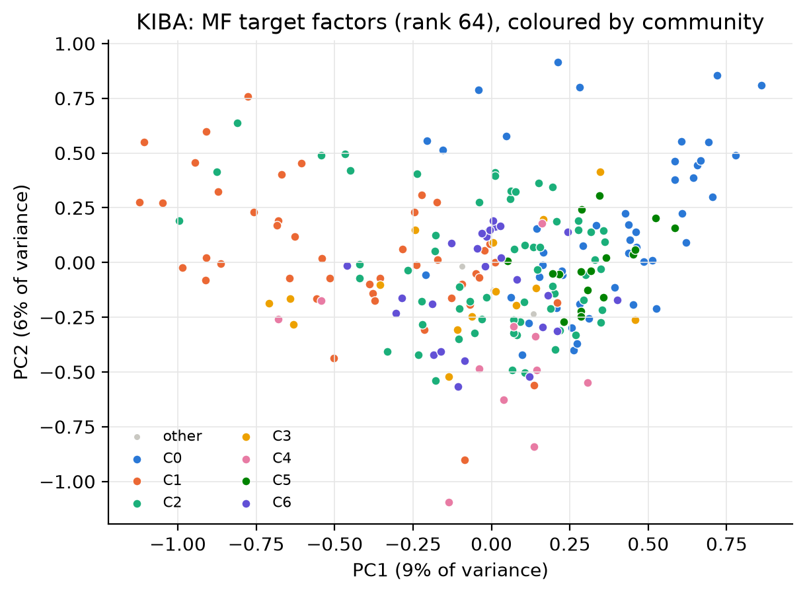

# SC4020 Project 2 — Drug–Target Binding Affinity

| Task | Scope | Status |
|---|---|---|
| **1 — Dataset analysis** | **KIBA** | ✅ complete ([below](#task-1--analysis-of-the-kiba-dataset)) |
| **2 — Collaborative filtering recommender** | **KIBA** | ✅ complete ([below](#task-2--collaborative-filtering-on-kiba)) |

---

# Task 1 — Analysis of the KIBA dataset

**Notebook:** [`notebooks/task1_kiba.ipynb`](notebooks/task1_kiba.ipynb) · **Figures:** [`figures/kiba/`](figures/kiba/) · **Tables:** [`results/kiba/`](results/kiba/) · **Cleaned data:** [`data/processed/`](data/processed/)

### Key findings at a glance

- **Sparse:** only 117,657 of 473,572 ligand–target positions are measured (**75.2 % missing**). Missing means *never tested*, not *non-binding*.
- **Hidden duplicates:** IDs are unique, but **43 ligand IDs are stereoisomers** that share a canonical SMILES. Merging them removes 597 redundant pairs; isomers disagree by 0.44 score units on average.
- **One abnormal ligand:** CHEMBL373751 accounts for 10 of the 20 extreme-low scores, including KIBA's only zero. Its scores average **3.3** against a dataset mean of **11.7**. It is flagged and kept.
- **Heaped scores:** **22.9 %** of all pairs score exactly **11.1 or 11.2**, a floor-like screening effect.
- **Ligand identity matters most:** knowing the ligand explains **41.7 %** of score variance; knowing the target explains only **14.1 %**.
- **Similar proteins bind alike:** target pairs in the top 5 % of sequence similarity have a median profile correlation of **0.54**, against **0.23** for dissimilar pairs.

---

## 1. What the data is

KIBA (Tang et al., 2014) combines three kinds of bioactivity measurement (Ki, Kd and IC50) for kinase inhibitors into one **KIBA score**. We use the transformed version released with DeepDTA (Öztürk et al., 2018), where **higher = stronger binding**.

| File (`data/kiba/`) | Content |
|---|---|
| `ligands_can.txt` / `ligands_iso.txt` | JSON `CHEMBL ID → SMILES` (canonical / isomeric), 2,111 ligands |
| `proteins.txt` | JSON `UniProt ID → amino-acid sequence`, 229 kinase targets |
| `kiba_binding_affinity_v2.txt` | 2,111 × 229 score matrix; `nan` = not measured |
| `kiba_drug_sim.txt`, `kiba_target_sim.txt` | Drug–drug (PubChem) and target–target (Smith–Waterman) similarity matrices |
| `folds/` | DeepDTA cross-validation indices (used only as a consistency check) |

**Table 1 — Data format examples**

Ligands (SMILES truncated):

| ligand_id | canonical SMILES | SMILES length |
|:--|:--|--:|
| CHEMBL1087421 | `COC1=C(C=C2C(=C1)CCN=C2C3=CC(=C(C=C3)Cl)Cl)Cl` | 45 |
| CHEMBL1088633 | `COC1=C(C=C2C(=C1)CCN=C2C3=CC(=CC=C3)Cl)Cl` | 41 |
| CHEMBL1090360 | `C1COCCN1C2=CC(=CC=C2)NC3=NC=CC(=N3)C4=C(N=C5N…` | 83 |

Targets (sequence truncated):

| target_id (UniProt) | amino-acid sequence | length |
|:--|:--|--:|
| O00141 | `MTVKTEAAKGTLTYSRMRGMVAILIAFMKQRRMGLNDFIQKIANN…` | 431 |
| O00311 | `MEASLGIQMDEPMAFSPQRDRFQAEGSLKKNEQNFKLAGVKKDIE…` | 574 |
| O00329 | `MPPGVDCPMEFWTKEENQSVVVDFLLPTGVYLNFPVSRNANLSTI…` | 1044 |

Score matrix (first 5 ligands × 6 targets):

| ligand \ target | O00141 | O00311 | O00329 | O00418 | O00444 | O14757 |
|:--|--:|:--|:--|:--|:--|:--|
| CHEMBL1087421 | 11.1 | `nan` | `nan` | `nan` | `nan` | `nan` |
| CHEMBL1088633 | 11.1 | `nan` | `nan` | `nan` | `nan` | `nan` |
| CHEMBL1090360 | 12.1 | 12 | `nan` | `nan` | `nan` | 12.12 |
| CHEMBL1688215 | 11.1 | `nan` | `nan` | `nan` | `nan` | 11.1 |
| CHEMBL1765781 | 12.1 | `nan` | `nan` | `nan` | `nan` | 12.1 |

The matrix is converted to a **long format** with one row per measured pair (`ligand_id, target_id, score`). That format is used for all analysis.

---

## 2. Problems found in the raw data

| # | Problem | Evidence | How we handle it |
|---|---|---|---|
| 1 | **Most pairs were never measured** | 365,165 of 483,419 positions are `nan` (75.54 %) | Drop from the observation table; never fill with 0 |
| 2 | **Stereoisomer duplicates** | 43 CHEMBL IDs share a canonical SMILES (32 groups, up to 8 isomers); their isomeric SMILES all differ | Merge by canonical SMILES and average repeated pairs (§3.2) |
| 3 | **An abnormal ligand** | CHEMBL373751's 11 scores range 0–10.9 (mean 3.3); every other ligand averages ≥ 9.4 | Flag and keep (§3.3, Fig. 5) |
| 4 | **Heaped values** | 11.2 and 11.1 alone account for 22.9 % of all pairs; 52 % of scores have a single decimal | Flag and keep; discussed with the KDE (Fig. 2) |
| 5 | **Very uneven coverage** | Ligands have 11–166 measured targets; targets have 11–1,432 measured ligands | Shown in Fig. 3; tested for bias in Fig. 4 |
| 6 | **Multi-component SMILES** | 21 SMILES contain salts or counter-ions (`.`) | Flagged (`is_salt`) in the ligand table, not altered |

No file was inconsistent. The notebook asserts that the matrix shape matches both ID lists, that the canonical and isomeric files list ligands in the same order, and that the DeepDTA fold indices cover exactly the 118,254 observed entries.

---

## 3. Cleaning — what we did and how

### 3.1 Cleaning log

| Step | Operation | Rows in | Rows out | Change | Note |
|--:|:--|:--|:--|:--|:--|
| 1 | Matrix → long format | 483,419 positions | 118,254 pairs | 365,165 NaN dropped | NaN = not measured (never set to 0) |
| 2 | Non-finite scores | 118,254 | 118,254 | 0 | no ±inf present |
| 3 | Range / input validity | 118,254 | 118,254 | 0 | all scores ≥ 0; all sequences use the 20 standard amino acids |
| 4 | Merge stereoisomers (canonical SMILES) | 118,254 | 117,657 | 597 merged | 473 pairs averaged |
| 5 | Abnormal-value flags | 117,657 | 117,657 | **0 removed** | 29,877 rows carry ≥ 1 flag |

KIBA has no raw Kd, so the brief's "require positive Kd" rule does not apply. The supplied scores are already on a transformed scale, so we do not transform them again.

### 3.2 Duplicates — checked at every identity level

Whether two records count as duplicates depends on how ligands and targets are identified, so we tested every key the dataset offers:

| Identity key | Records | Unique | Redundant |
|:--|--:|--:|--:|
| Ligand ID (CHEMBL) | 2,111 | 2,111 | 0 |
| Isomeric SMILES | 2,111 | 2,111 | 0 |
| **Canonical SMILES** | 2,111 | **2,068** | **43** |
| Target ID (UniProt) | 229 | 229 | 0 |
| Protein sequence | 229 | 229 | 0 |
| (ligand ID, target ID) pair | 118,254 | 118,254 | 0 |
| **(canonical SMILES, sequence) pair** | 118,254 | **117,657** | **597** |

Duplicates appear **only** when ligands are identified by canonical SMILES. Canonical SMILES drops 3-D stereochemistry, so stereoisomers collapse to the same string, and any model that reads canonical SMILES would see one input with several labels. Before merging, we measured how much the isomers actually disagree:

| Stereoisomer agreement | Value |
|:--|:--|
| isomer pairs measured on the same target | 952 |
| mean / median absolute difference | 0.441 / 0.301 |
| identical scores | 24.1 % |
| pairs differing by more than 1.0 | 86 |
| Pearson r between isomers | 0.857 |

The isomers agree strongly (r = 0.86) but not perfectly. Each group is merged into its **lowest CHEMBL ID**, and repeated pairs take the **mean** score. For the 29 two-member groups the mean and median are identical anyway. To keep the disagreement visible, every cleaned row records `n_merged`, `score_std` and `source_ids`, and `kiba_ligand_map.csv` maps all 2,111 original IDs to their representative.

### 3.3 Abnormal values — flagged, never removed

Outliers use Tukey's *far-out* fences (Q1 − 3·IQR = **9.03**, Q3 + 3·IQR = **14.10**).

| Flag | Rule | Rows | % | Interpretation |
|:--|:--|--:|--:|:--|
| `flag_zero` | score = 0 | 1 | 0.00 % | KIBA's only zero, on target P53350. Kept, because the brief asks to keep valid zero scores |
| `flag_far_low` | score < 9.03 | 20 | 0.02 % | Extremely weak scores; 10 come from one ligand |
| `flag_low_ligand` | > 50 % of a ligand's scores are far-low | 11 | 0.01 % | CHEMBL373751, a ligand-level anomaly that likely comes from the score transformation of its source data |
| `flag_spike` | score exactly 11.1 or 11.2 | 26,922 | 22.88 % | Heaped values, consistent with rounded or thresholded source measurements (a screening-floor effect) |
| `flag_far_high` | score > 14.10 | 2,934 | 2.49 % | Very strong binders. Genuine, and the most interesting records |

**Sensitivity check:** what happens to the summary statistics if each flagged group is left out?

| Subset | Pairs | Mean | Median | SD | Skew | Min | Max | % ≥ 12.1 |
|:--|--:|--:|--:|--:|--:|--:|--:|--:|
| all cleaned pairs | 117,657 | 11.721 | 11.527 | 0.834 | 1.177 | 0.0 | 17.2 | 21.0 % |
| without far-low | 117,637 | 11.723 | 11.532 | 0.829 | 1.338 | 9.1 | 17.2 | 21.0 % |
| without low ligand | 117,646 | 11.722 | 11.531 | 0.830 | 1.328 | 7.1 | 17.2 | 21.0 % |
| without 11.1/11.2 spikes | 90,735 | 11.889 | 11.800 | 0.883 | 0.792 | 0.0 | 17.2 | 27.2 % |
| without far-high | 114,723 | 11.649 | 11.500 | 0.706 | 0.529 | 0.0 | 14.09 | 19.0 % |

The 20 extreme-low scores barely move the mean, but they inflate the spread, so they are worth flagging rather than worth deleting. The **spikes** matter much more: without them the median rises from 11.53 to 11.80 and the share of strong binders from 21 % to 27 %. The heaped values pull the distribution towards weak binding.

### 3.4 Counts — original vs cleaned

| | Original | Cleaned (deduplicated) |
|:--|:--|:--|
| ligands | 2,111 | **2,068** |
| targets | 229 | 229 |
| observed pairs | 118,254 | **117,657** |
| matrix positions | 483,419 | 473,572 |
| **sparsity** (missing / all positions) | **75.54 %** | **75.16 %** |
| mean observations per ligand | 56.0 | 56.9 |
| mean observations per target | 516.4 | 513.8 |

### 3.5 Outputs (`data/processed/`)

| File | Content |
|:--|:--|
| `kiba_pairs_clean.csv` | one row per measured pair: `ligand_id, target_id, score, score_std, n_merged, source_ids`, plus the five flag columns |
| `kiba_ligands.csv` | 2,068 ligands: canonical/isomeric SMILES, member IDs, `is_salt`, `is_low_ligand`, number of targets |
| `kiba_targets.csv` | 229 targets: sequence, length, number of ligands |
| `kiba_ligand_map.csv` | every original CHEMBL ID → its representative ID |

---

## 4. Visualisation

### Figure 1 — Ligand–target heatmap



Rows and columns are sorted by how many measurements they have. **White = not measured.** The matrix is not randomly sparse; it has a **block structure**. About 500 ligands were profiled against roughly the same 125 targets (top-left), and other ligand groups were tested only on specific target panels (for example the isolated block near targets 165–175). This is how screening campaigns produce data, and it means missing entries cluster rather than scatter. The zoom (b) shows that inside the dense block most scores sit in a narrow band (light blue), with strong binders (dark) concentrated in certain ligand rows and target columns.

### Figure 2 — Score distribution (KDE)



**(a)** The observed scores are strongly **right-skewed** (skew 1.18): a tall body between 11 and 12 and a long tail of strong binders up to 17.2. **21.0 %** of pairs reach the strong-binder threshold of 12.1 (Tang et al., 2014; He et al., 2017). The default KDE (Scott bandwidth) gives a smooth picture, but a narrow-bandwidth KDE and the histogram reveal **discrete spikes** at 11.1, 11.2, 11.5 and 11.9. KIBA scores are partly discretised, so a smooth KDE over-states how continuous they are.
**(b)** On a log-scaled count axis, the 20 far-low scores (orange) sit completely apart from the rest of the data, with a gap between about 2 and 6. They are invisible on a density plot, which is why both views are needed.

### Figure 3 — How many measurements each ligand and target has



Coverage is very uneven. **(a)** 830 ligands (40 %) were tested on only 11–20 targets (median 31), while a second group of 520 ligands was tested on 100 or more. **(b)** 51 targets have fewer than 100 measured ligands, while the median target has 567. Any method that compares ligands by their shared targets will have far more information for some ligands than for others.

### Figure 4 — Missing ≠ non-binding: is missingness linked to the score?


If pairs were missing at random, a ligand's average score would not depend on how many targets it was tested on. For **ligands** there is a small but significant link (Spearman ρ = 0.16, p = 1.4 × 10⁻¹³). Lightly-tested ligands vary much more and include both the weakest and the strongest averages. For **targets** there is none (ρ = 0.03, p = 0.63). The data are **not missing completely at random**: which pairs were measured depends on the ligand. That is a further reason not to read a missing entry as "does not bind".

### Figure 5 — The abnormal ligand CHEMBL373751


On each of its 11 targets, CHEMBL373751 (orange) scores far below what every other ligand scores on the same target (grey boxes). On 10 of the 11 it falls below the far-low fence, and it includes KIBA's only zero. Because the whole profile is shifted, not just one value, this looks like a systematic issue with this ligand's source data rather than random noise. We keep it with a `flag_low_ligand` marker so later tasks can choose whether to include it.

### Figure 6 — Stereoisomer consistency



**(a)** Scores of stereoisomer pairs on the same target lie close to the diagonal (r = 0.86); most fall inside the ±1 band. **(b)** 24 % agree exactly and the median gap is 0.30, but 86 pairs differ by more than 1.0, so stereochemistry sometimes changes binding. Averaging is a reasonable compromise when the input representation cannot distinguish isomers; the per-pair standard deviation is kept so this label noise stays visible.

### Figure 7 — Target properties



**(a)** Targets differ in how strongly they are bound: median scores range from **10.10 to 13.16**, but only 14 targets have a median above the 12.1 strong-binder line. The staircase of identical medians (11.1, 11.2, …) is the heaping effect from Fig. 2 showing up at target level. **(b)** The supplied Smith–Waterman similarity matrix, reordered by hierarchical clustering, shows clear diagonal blocks. These are **55 families** of related kinases (average similarity > 0.5, the largest with 8 members), while most target pairs are dissimilar (median similarity 0.08).

### Figure 8 — Do similar molecules / proteins have similar binding profiles?



For every pair of ligands (or targets) sharing at least 10 measured partners, we correlate their scores on those shared partners and plot the result against their structural similarity.

| Entity | Pairs | Spearman ρ (similarity, r) | Median r, bottom-50 % similarity | Median r, top-5 % similarity |
|:--|--:|--:|--:|--:|
| ligand | 842,004 | 0.072 | 0.12 | 0.30 |
| target | 17,096 | 0.213 | 0.23 | 0.54 |

**Targets:** sequence similarity is a meaningful signal. Related kinases have clearly more similar binding profiles. **Ligands:** structural similarity matters only at the very top, where near-identical compounds bind alike, and is weak elsewhere. This is the "guilt-by-association" principle behind similarity-based affinity prediction (He et al., 2017; Kim et al., 2025), measured directly on the KIBA data.

---

## 5. Where does the variation come from?

A two-way additive decomposition (score ≈ overall mean + ligand effect + target effect), fitted by alternating least squares on the observed pairs. This is a classical ANOVA-style summary, not a predictive model.

| Explained by | R² (share of score variance) |
|:--|--:|
| ligand identity only | 41.7 % |
| target identity only | 14.1 % |
| ligand + target (additive) | 51.9 % |
| residual (ligand × target interaction + noise) | 48.1 % |

**Which compound** it is matters about three times more than **which kinase** it is: some ligands bind strongly across the board (promiscuous inhibitors), others weakly. Still, almost half of the variation is *specific* to the ligand–target combination, which simple per-ligand or per-target averages cannot capture.

---

## 6. Limitations

- The cause of the heaped values and of CHEMBL373751's profile can only be inferred: the DeepDTA release does not include the raw Ki/Kd/IC50 records behind each KIBA score.
- Salt and counter-ion SMILES are flagged, not standardised. Stripping them properly needs a cheminformatics toolkit such as RDKit.
- Representing ligands by canonical SMILES deliberately ignores stereochemistry. Fig. 6 shows this costs some information (86 isomer pairs differ by > 1).
- The similarity analysis (Fig. 8) is correlational and uses only pairs with at least 10 shared partners.

---

# Task 2 — Collaborative filtering on KIBA

**Notebooks:** [`notebooks/task2_kiba_split.ipynb`](notebooks/task2_kiba_split.ipynb) · [`notebooks/task2_kiba_cf.ipynb`](notebooks/task2_kiba_cf.ipynb) · **Checkpoints:** [`saved_models/`](saved_models/) · **Figures:** [`figures/kiba/`](figures/kiba/) · **Tables:** [`results/kiba/`](results/kiba/) · **Split:** [`data/splits/kiba_split.csv`](data/splits/kiba_split.csv)

### Key findings at a glance

- **Every CF model beats the additive bias baseline:** Matrix factorisation cuts test MSE from **0.377** (bias baseline $\mu + b_x + b_i$) to **0.201**, raises global CI from **0.781 to 0.856**, and lifts Hit@5 from **0.672 to 0.892** (NDCG@5 **0.744 → 0.880**).
- **Ligand-based CF beats Target-based CF on KIBA (MSE 0.225 vs 0.251, Hit@1 0.570 vs 0.462), reversing DAVIS:** KIBA has no near-duplicate mutant/phosphorylated sibling targets to give item-kNN a shortcut, and has $30\times$ more ligands (2,068 vs 68) from which user-kNN can pull co-screened chemical analogues.
- **Sparsity flips the kNN winner for lightly tested ligands (E3):** for ligands with $\le 10$ training pairs, Ligand-based CF falls back to the bias baseline on **25.6 %** of test pairs and loses to Target-based CF (MSE **0.625 vs 0.601**). Above 10 training pairs, Ligand-based CF's fallback drops below 7.4 % and it wins in every denser bin.
- **Not an artefact of the 11.1 / 11.2 spike (E4):** on non-spike pairs alone ($n = 13{,}611$), MF cuts MSE from **0.444 to 0.240**; on strong binders ($\ge 12.1$, $n = 3{,}735$), MF nearly halves MSE from **1.097 to 0.576**.
- **Abnormal ligand trade-off (E4):** on the 8 test pairs flagged as far-low or belonging to CHEMBL373751 ($b_x = -8.76$), shrinkage-stabilised kNN stays close to $b_{xi}$ (MSE **13.30–13.45** vs **14.29** for bias), whereas unclipped MF over-extrapolates (**19.27**).
- **Case study from `saved_models/kiba_cf.npz`:** the reloaded model ranks the true best test target **1st** (`Hit@1 = True`) for all three brief-specified ligands (`CHEMBL1967538`, `CHEMBL2004544`, `CHEMBL565612`), including placing `CHEMBL565612`'s extreme-high target `Q05655` (score **14.99**) **1st of 23** where the bias baseline ranks it **20th**.

---

## 1. Framing and data split

- **User = ligand** (2,068 deduplicated ligands, `lig_id` $0\ldots 2067$)
- **Item = target** (229 UniProt kinases, `tgt_id` $0\ldots 228$)
- **Rating = KIBA score** (higher = stronger binding; missing = never tested, kept as `NaN`)

The 117,657 cleaned pairs are split **70 % / 15 % / 15 %** (`SEED = 42`), stratified by `flag_spike` (whether the score sits at the heaped 11.1 / 11.2 values) so every partition has the same 22.9 % spike share. All 2,068 ligands and 229 targets already have $\ge 4$ training pairs (median 22, mean 39.8, max 123), so **0 pairs needed moving** to satisfy the warm-start coverage rule, and no `(lig_id, tgt_id)` pair appears in more than one partition.

| Partition | Pairs | Share | Ligands | Targets | Share spike (11.1 / 11.2) | Mean score | Pairs moved for coverage |
|:--|--:|--:|--:|--:|--:|--:|--:|
| `train` | 82,359 | 70.0 % | 2,068 | 229 | 22.9 % | 11.722 | — |
| `val` | 17,649 | 15.0 % | 1,971 | 228 | 22.9 % | 11.719 | — |
| `test` | 17,649 | 15.0 % | 1,953 | 226 | 22.9 % | 11.721 | — |
| **total** | **117,657** | **100.0 %** | **2,068** | **229** | **22.9 %** | **11.721** | **0** |

---

## 2. Models and hyperparameter tuning

All models build on the additive bias baseline fitted on `R_train` ($2{,}068 \times 229$, 17.4 % observed):

$$b_{xi} = \mu + b_x + b_i, \qquad b_x = \bar r_{x\cdot} - \mu, \qquad b_i = \bar r_{\cdot i} - \mu$$

1. **Neighbourhood CF (`user_knn` = Ligand-based, `item_knn` = Target-based):**
   $$\hat r_{xi} = b_{xi} + \frac{\sum_{j \in N(i;x)} s_{ij}\,(r_{xj} - b_{xj})}{\sum_{j \in N(i;x)} |s_{ij}|}, \qquad s'_{ij} = \mathbb{1}[n_{ij} \ge m]\,\frac{n_{ij}}{n_{ij} + \lambda}\,s_{ij}$$
   tuned over the 960-setting grid $k \in \{3, 5, 6, 8, 10, 20, 40, 80\} \times \lambda \in \{0, 10, 25, 50, 100\} \times m \in \{2, 5, 10\} \times \text{sim} \in \{\text{Pearson}, \text{centred cosine}\} \times \text{keep\_negative} \in \{\text{False}, \text{True}\}$.
2. **Matrix factorisation (Weighted-$\lambda$ ALS):**
   $$\hat r_{xi} = \mu + b_x + b_i + p_x^\top q_i$$
   fitted by alternating least squares with per-entity penalty $\lambda \cdot n_x$ (Zhou et al., 2008) and early stopping on validation MSE (patience 5 sweeps), tuned over $\text{rank} \in \{2, 4, 8, 16, 32, 48, 64\} \times \lambda \in \{0.001, 0.01, 0.025, 0.05, 0.1, 0.5, 1.0\}$ (49 settings).

**Co-rated support on `R_train`:** across all 2.14M ligand pairs, **15.1 %** share zero training targets, **71.2 %** share $\ge 2$, and only **25.4 %** share $\ge 10$ (median positive overlap: **5** targets). Across all 26,106 target pairs, **9.3 %** share zero training ligands and **56.3 %** share $\ge 10$ (median positive overlap: **33** ligands).

**Chosen settings** (selected by lowest validation MSE, with ties within 0.005 broken by validation CI):

| Model | `sim` | `shrink` ($\lambda$) | `min_common` ($m$) | `keep_negative` | $k$ | `rank` | `lam` | `sweeps` | Val MSE | Val CI |
|:--|:--|--:|--:|:--|--:|--:|--:|--:|--:|--:|
| **Ligand-based CF** | `pearson` | 50 | 2 | `False` | 8 | — | — | — | 0.2215 | 0.8482 |
| **Target-based CF** | `pearson` | 25 | 10 | `False` | 5 | — | — | — | 0.2541 | 0.8252 |
| **Matrix factorisation** | — | — | — | — | — | 64 | 0.025 | 41 | **0.1912** | **0.8565** |



---

## 3. Main test evaluation (E1) and model persistence

- **Concordance Index (CI):** computed with the brief's formula $\text{CI} = (\tau_b \sqrt{B/A} + 1)/2$, where $A$ and $B$ are the numbers of pair comparisons untied in true and predicted scores.
- **Per-ligand ranking metrics:** evaluated over the 1,492 test ligands that have $\ge 2$ held-out test targets and non-constant true scores (1,070 qualify for Hit@5 with $\ge 5$ test targets; median 10 candidates per ligand). `NDCG@5` uses $\max(\text{score} - 11.2, 0)$ as the gain so heaped spike pairs add zero gain.

| Model | MSE train | MSE val | MSE test | RMSE test | CI test | CI / ligand | Hit@1 | Hit@5 | MRR | NDCG@5 | Mean rank of best | Fallback % | MSE non-spike | CI non-spike |
|:--|--:|--:|--:|--:|--:|--:|--:|--:|--:|--:|--:|--:|--:|--:|
| **Global mean** | 0.6913 | 0.7075 | 0.7073 | 0.8410 | 0.5000 | 0.5000 | 0.1957 | 0.4607 | 0.3883 | 0.5709 | 5.85 | — | 0.8211 | 0.5000 |
| **Ligand mean** | 0.3992 | 0.4384 | 0.4325 | 0.6576 | 0.7036 | 0.5000 | 0.1957 | 0.4607 | 0.3883 | 0.5709 | 5.85 | — | 0.4825 | 0.7014 |
| **Target mean** | 0.5932 | 0.6155 | 0.6072 | 0.7792 | 0.6871 | 0.6721 | 0.3298 | 0.6720 | 0.5215 | 0.7439 | 3.97 | — | 0.7379 | 0.6329 |
| **Bias baseline** | 0.3466 | 0.3850 | 0.3765 | 0.6136 | 0.7806 | 0.6721 | 0.3298 | 0.6720 | 0.5215 | 0.7439 | 3.97 | — | 0.4439 | 0.7472 |
| **Random ranking** | — | — | — | — | — | 0.4994 | 0.1868 | 0.4717 | 0.3851 | 0.5705 | 5.84 | — | — | — |
| **Target-based CF** | 0.2266 | 0.2541 | 0.2515 | 0.5015 | 0.8269 | 0.7345 | 0.4618 | 0.8374 | 0.6418 | 0.8365 | 2.79 | 0.21 % | 0.2973 | 0.8042 |
| **Ligand-based CF** | 0.1246 | 0.2215 | 0.2246 | 0.4739 | 0.8473 | **0.7981** | **0.5697** | 0.8813 | **0.7210** | 0.8742 | 2.38 | 2.39 % | 0.2678 | 0.8252 |
| **Matrix factorisation** | **0.0349** | **0.1912** | **0.2007** | **0.4479** | **0.8562** | 0.7920 | 0.5523 | **0.8916** | 0.7129 | **0.8801** | **2.29** | — | **0.2400** | **0.8337** |

**Saved checkpoints (`saved_models/`):** Matrix factorisation has the lowest validation MSE (0.1912) and is saved as `saved_models/kiba_cf.npz` (`1.2 MB`, plus `kiba_user_knn.npz`, `kiba_item_knn.npz`, and `kiba_mf.npz`). Each archive stores the learned parameters, matrix indices, CHEMBL/UniProt labels, `score_scale`, `seed`, and `split_file`, and is verified with `np.load(..., allow_pickle=False)` and `assert np.allclose(pred_before, pred_after)`.

---

## 4. Extended analyses (E2, E3, E4 & MF factors)

### E2 — Target communities and target degree

Louvain community detection is run on the **training pairs only** (bipartite graph of strong training pairs $\ge 12.1$, weighted by score), finding 7 communities with $\ge 10$ targets (modularity 0.339) plus 3 targets with no strong training ligand (`other`, 10 test pairs). Ligand-based CF beats Target-based CF in 6 of the 7 communities (`C0–C4, C6`); Target-based CF wins in `C5` (0.150 vs 0.171), a tight kinase family cluster. Across all communities and degree bins, MF achieves the lowest test MSE.



### E3 — Per-ligand sparsity and neighbour availability

Test pairs are binned by how many training pairs their ligand has. For the sparsest ligands ($\le 10$ training pairs), Ligand-based CF has no usable neighbour on **25.6 %** of test pairs and loses to Target-based CF (**0.625 vs 0.601**). Once a ligand has $> 10$ training pairs, Ligand-based CF's fallback drops to 7.4 % (`11–20`), 1.9 % (`21–40`), and 0.0 % (`> 80`), and it beats Target-based CF in every denser bin.

| Ligand train pairs | Pairs | Share $\ge 12.1$ | Bias baseline | Ligand-based CF | Target-based CF | MF | Fallback % (Ligand CF) | Median usable nbrs (Ligand CF) | Fallback % (Target CF) | Median usable nbrs (Target CF) |
|:--|--:|--:|--:|--:|--:|--:|--:|--:|--:|--:|
| `<=10` | 1,191 | 34.8 % | 0.824 | 0.625 | 0.601 | **0.527** | 25.61 % | 76 | 0.67 % | 7 |
| `11-20` | 1,246 | 26.8 % | 0.691 | 0.499 | 0.541 | **0.434** | 7.38 % | 182 | 1.44 % | 13 |
| `21-40` | 1,190 | 17.1 % | 0.358 | 0.218 | 0.258 | **0.196** | 1.93 % | 315 | 0.42 % | 30 |
| `41-80` | 4,697 | 18.6 % | 0.316 | 0.181 | 0.209 | **0.166** | 0.02 % | 400 | 0.04 % | 50 |
| `>80` | 9,325 | 20.5 % | 0.311 | 0.160 | 0.188 | **0.146** | 0.00 % | 431 | 0.04 % | 85 |



### E4 — Heaped spike values (`11.1 / 11.2`) and abnormal records

Spike-vs-spike pairs make up only **5.2 %** of all test sample pairs (vs 48.5 % floor-vs-floor ties on DAVIS). A constant `11.15` predictor wins on spike pairs (MSE 0.0025) but fails overall (MSE 1.034) and on strong binders (3.909). On the 8 test pairs flagged as `flag_far_low` or belonging to the abnormal ligand `CHEMBL373751` (5 training pairs, mean 2.96, $b_x = -8.76$), kNN stays close to $b_{xi}$ (MSE 13.30–13.45 vs 14.29 for bias), whereas MF over-extrapolates (`MSE 19.27`) because `CHEMBL373751`'s training scores span `0.0` to `9.0`.

| Model | MSE all ($17{,}649$) | MSE spike ($4{,}038$) | MSE non-spike ($13{,}611$) | MSE strong $\ge 12.1$ ($3{,}735$) | MSE far-low / abnormal ($8$) | CI non-spike |
|:--|--:|--:|--:|--:|--:|--:|
| **Ligand mean** | 0.4325 | 0.2640 | 0.4825 | 1.2892 | 13.9401 | 0.7014 |
| **Bias baseline** | 0.3765 | 0.1496 | 0.4439 | 1.0972 | 14.2859 | 0.7472 |
| **Target-based CF** | 0.2515 | 0.0968 | 0.2973 | 0.6625 | **13.2995** | 0.8042 |
| **Ligand-based CF** | 0.2246 | 0.0789 | 0.2678 | 0.6067 | 13.4543 | 0.8252 |
| **Matrix factorisation** | **0.2007** | 0.0679 | **0.2400** | **0.5762** | 19.2689 | **0.8337** |
| **Constant 11.15** | 1.0338 | **0.0025** | 1.3398 | 3.9094 | 44.4781 | 0.5000 |

### MF target factors

PCA projection of the rank-64 target factors $q_i$, coloured by the train-only Louvain communities from E2 (mean Euclidean distance within the same community: **1.763** vs **1.853** between communities):



---

## 5. Case study (loaded from `saved_models/kiba_cf.npz`)

The three test ligands suggested in the brief span KIBA's coverage and activity spectrum:

| Ligand | `lig_id` | Train pairs | Test candidates | Test share spike | Test $\ge 12.1$ | Max test score | Model | Ligand MSE | Ligand CI | Rank of true best | Hit@1 | Hit@5 | NDCG@5 |
|:--|--:|--:|--:|--:|--:|--:|:--|--:|--:|--:|:--:|:--:|--:|
| **CHEMBL1967538** | 884 | 25 | 3 | 0.0 % | 0 | 10.700 | **CF (`kiba_cf.npz`)** | **0.049** | **1.000** | **1** (`Q13627`) | **True** | — | — |
| | | | | | | | Bias baseline | 0.148 | 0.667 | 2 (`Q13627`) | False | — | — |
| **CHEMBL2004544** | 537 | 65 | 23 | 30.4 % | 5 | 12.600 | **CF (`kiba_cf.npz`)** | **0.038** | **0.918** | **1** (`O00311`) | **True** | **True** | **0.956** |
| | | | | | | | Bias baseline | 0.145 | 0.700 | 1 (`O00311`) | True | True | 0.677 |
| **CHEMBL565612** | 640 | 123 | 23 | 21.7 % | 4 | 14.986 | **CF (`kiba_cf.npz`)** | **0.313** | **0.721** | **1** (`Q05655`) | **True** | **True** | **0.993** |
| | | | | | | | Bias baseline | 0.806 | 0.608 | 20 (`Q05655`) | False | False | 0.265 |

- **CHEMBL1967538 (sparse, weak-binding case):** 25 training pairs and 3 held-out test targets (`Q13627 = 10.7`, `P50750 = 10.3`, `P35968 = 10.2`), all below 11.2. The bias baseline ranks `P50750` 1st because of its higher global target bias; CF reverses the top two and orders all three targets perfectly (`CI = 1.000`, `Hit@1 = True`).
- **CHEMBL2004544 (typical, moderate-coverage selective case):** both models put the true best `O00311` (`12.6`) 1st, but the bias baseline fills ranks 3–5 with globally popular non-binders (`11.3–11.6`) and pushes the second-best true binder `Q8IW41` (`12.5`) to 6th (`NDCG@5 = 0.677`). CF ranks `Q8IW41` 2nd and places four of the five strong binders in the top 5 (`NDCG@5 = 0.956`).
- **CHEMBL565612 (dense, potent inhibitor with an extreme-high target):** its strongest test target is `Q05655` (PKC-$\delta$, score **14.986**, `flag_far_high`). Because `Q05655` is not globally promiscuous, its target bias $b_i$ is small and the bias baseline ranks it **20th of 23** (`NDCG@5 = 0.265`). CF ranks `Q05655` **1st** (predicted `13.304`), followed by the other three strong binders `Q86V86` (`12.6`), `Q9Y4K4` (`12.9`) and `Q16513` (`12.7`) at ranks 2–4 (`NDCG@5 = 0.993`).

---

## Reproduce

```bash
python -m venv .venv
# Windows: .venv\Scripts\activate   |   macOS/Linux: source .venv/bin/activate
pip install -r requirements.txt
jupyter nbconvert --to notebook --execute --inplace notebooks/task1_kiba.ipynb
jupyter nbconvert --to notebook --execute --inplace notebooks/task2_kiba_split.ipynb
jupyter nbconvert --to notebook --execute --inplace --ExecutePreprocessor.timeout=-1 notebooks/task2_kiba_cf.ipynb
```

Every number, table, figure and model checkpoint on this page is regenerated by those notebooks.

## Repository structure

```
data/
  kiba/                        original KIBA files from DeepDTA (unchanged)
  processed/                   cleaned KIBA tables (output of Task 1)
  splits/                      70/15/15 train/val/test split (output of Task 2 split)
notebooks/
  task1_kiba.ipynb             Task 1 — KIBA analysis and cleaning
  task2_kiba_split.ipynb       Task 2 — KIBA train/val/test split
  task2_kiba_cf.ipynb          Task 2 — KIBA collaborative filtering & case study
saved_models/
  kiba_cf.npz                  best validation CF model (Matrix factorisation)
  kiba_user_knn.npz            Ligand-based kNN checkpoint
  kiba_item_knn.npz            Target-based kNN checkpoint
  kiba_mf.npz                  Matrix factorisation checkpoint
figures/kiba/                  all Task 1 & Task 2 KIBA figures (PNG)
results/kiba/                  all Task 1 & Task 2 KIBA tables (CSV + Markdown)
```

## References

1. Öztürk, H., Özgür, A., & Ozkirimli, E. (2018). DeepDTA: deep drug–target binding affinity prediction. *Bioinformatics*, 34(17), i821–i829. Data and loading convention: <https://github.com/hkmztrk/DeepDTA/tree/master/data>
2. Tang, J., Szwajda, A., Shakyawar, S., et al. (2014). Making sense of large-scale kinase inhibitor bioactivity data sets: a comparative and integrative analysis. *J. Chem. Inf. Model.*, 54(3), 735–743.
3. He, T., Heidemeyer, M., Ban, F., Cherkasov, A., & Ester, M. (2017). SimBoost: a read-across approach for predicting drug–target binding affinities using gradient boosting machines. *J. Cheminformatics*, 9, 24.
4. Kim, Y., et al. (2025). MixingDTA: improved drug–target affinity prediction by extending mixup with guilt-by-association. *Bioinformatics*, 41(Supplement_1), i105–i114.
5. Tukey, J. W. (1977). *Exploratory Data Analysis*. Addison-Wesley.
6. Zhou, Y., Wilkinson, D., Schreiber, R., & Pan, R. (2008). Large-scale parallel collaborative filtering for the Netflix Prize. *Proc. AAIM*, LNCS 5034, 337–348.
